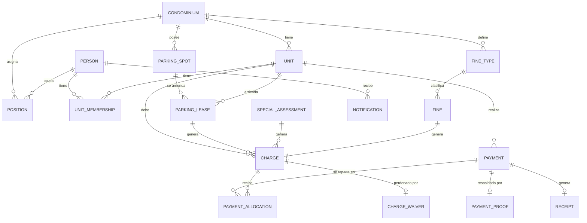

# 03 — Modelo de dominio

*Estado: aprobado.*

## Parqueaderos

- **Amarillos:** se compran y forman parte de la casa en las escrituras. No generan cobros; en el MVP son solo un dato de la unidad.
- **Azules:** son del condominio y se arriendan.

**Reglas de arriendo de parqueaderos azules:**

- **RN-18.** Solo pueden arrendarlos propietarios o inquilinos del conjunto.
- **RN-19.** Una unidad puede arrendar cualquier cantidad de parqueaderos azules.
- **RN-20.** El arriendo se formaliza con una carta de compromiso y se renueva mes a mes.
- **RN-21.** El arriendo termina cuando el arrendatario lo deja o cuando se le retira por incumplimiento de pago.
- **RN-22.** El arriendo de un parqueadero azul pertenece a la unidad, no a la persona; se registra quién firmó la carta de compromiso.
- **RN-23.** Si queda deuda de un arriendo firmado por un inquilino, la directiva decide caso por caso si la mantiene a cargo del propietario o la condona. La condonación exige motivo y queda registrada con autor y fecha. Ver RN-24.
- **RN-24.** Cualquier cobro puede condonarse con doble aprobación: la tesorera o el presidente la registra y el otro la aprueba. Hasta que ambos la aprueben, la deuda sigue vigente.
- **RN-25.** Cuando un inquilino arrienda un parqueadero azul, el propietario de la unidad recibe un aviso.

## Personas, unidades y roles

- **RN-26.** Una persona puede ser propietaria de varias unidades, una unidad puede tener varios propietarios, y una misma persona puede ser propietaria de una unidad e inquilina de otra al mismo tiempo.
- **RN-27.** El rol de propietario o inquilino no pertenece a la persona, sino a su vínculo con cada unidad. Cada vínculo tiene fecha de inicio y, cuando termina, fecha de fin.
- **RN-28.** Los cargos del condominio (tesorera, presidente, vicepresidente, secretario, guardia) son independientes de los vínculos con unidades: la tesorera puede ser también propietaria de una casa.
- **RN-29.** Una persona inicia sesión una sola vez y ve todas sus unidades; los permisos se evalúan según su vínculo con la unidad que está consultando.
- **RN-30.** Todos los propietarios de una unidad reciben los mismos avisos y recordatorios, y pueden hacer las mismas acciones sobre ella. Si dos propietarios hacen acciones contrarias, vale la última y ambas quedan registradas.

## Entidades

| Entidad | Qué representa | Se relaciona con |
| --- | --- | --- |
| Condominio | El conjunto; todo cuelga de él | Su configuración: tipos de unidad, montos, catálogo de multas, plazos, módulos y reglamento |
| Unidad | Casa o local comercial | Condominio; guarda su tipo y sus parqueaderos amarillos |
| Persona | Alguien con acceso al sistema | Sus vínculos y cargos |
| Vínculo | Relación persona–unidad: propietario o inquilino, con fechas | Persona y Unidad; en el inquilino guarda si puede subir comprobantes |
| Cargo | Rol en el condominio: tesorera, presidente, vicepresidente, secretario o guardia, con fechas | Persona y Condominio |
| Parqueadero azul | Espacio del condominio que se arrienda | Condominio |
| Arriendo | Arriendo mes a mes de un parqueadero a una unidad | Parqueadero, Unidad y la persona que firmó |
| Cobro | Toda deuda: concepto, monto, vencimiento | Unidad; nace de una alícuota, un arriendo, una cuota extraordinaria o una multa |
| Cuota extraordinaria | Decisión de asamblea con monto por unidad y fecha límite | Genera un cobro por unidad |
| Tipo de multa | Entrada del catálogo del reglamento con su monto | Condominio |
| Multa | Sanción registrada por un guardia | Unidad, tipo de multa y el guardia; genera un cobro |
| Pago | Dinero recibido, por transferencia o en efectivo | Unidad, y comprobante si es transferencia |
| Comprobante | Imagen y datos extraídos: monto, fecha, banco, número | Pago |
| Aplicación | Parte de un pago que abona a un cobro (el reparto de RN-11) | Pago y Cobro |
| Recibo | Prueba de pago con número único, inmutable | Pago confirmado |
| Condonación | Perdón de una deuda con doble aprobación | Cobro, quien la registró y quien la aprobó |
| Notificación | Cada aviso enviado, con su estado de envío | Persona; evita envíos duplicados |

**El saldo de un cobro no se guarda, se calcula:** monto del cobro menos las aplicaciones de pagos confirmados, o cero si fue condonado. Así la deuda nunca se desactualiza.

## Estados

| Entidad | Estados | Quién mueve |
| --- | --- | --- |
| Pago | Pendiente → Confirmado → Anulado; Pendiente → Rechazado (con motivo) | La tesorera |
| Multa | Vigente → Anulada (con motivo) | El guardia que la registró o el presidente |
| Condonación | Solicitada → Aprobada o Rechazada | Tesorera y presidente (uno registra, el otro aprueba) |
| Arriendo | Activo → Terminado (por renuncia o incumplimiento) | La tesorera |
| Cobro | Se calcula: pendiente, pagado, en mora o condonado | Nadie lo mueve a mano |

## Diagrama entidad-relación

Los nombres están en inglés, según el glosario de [07-ia.md](07-ia.md).

Todo lo que se debe (alícuota, arriendo, cuota extraordinaria o multa) es un cobro de una unidad. Los pagos confirmados lo saldan a través de sus aplicaciones, y una condonación aprobada lo perdona.
