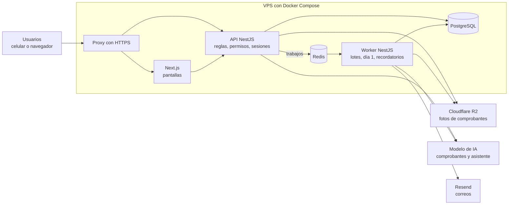

# 04 — Arquitectura

*Estado: aprobado.*

## Decisiones (ADR)

| ADR | Decisión |
| --- | --- |
| [001](adr/ADR-001-stack.md) | Next.js + NestJS en TypeScript |
| [002](adr/ADR-002-base-de-datos.md) | PostgreSQL compartido con `condominiumId` y Row-Level Security |
| [003](adr/ADR-003-despliegue.md) | VPS con Docker Compose |
| [004](adr/ADR-004-cola.md) | BullMQ + Redis para la cola |
| [005](adr/ADR-005-almacenamiento.md) | Cloudflare R2 para comprobantes |
| [006](adr/ADR-006-lectura-comprobantes.md) | Modelo de IA con visión para leer comprobantes |
| [007](adr/ADR-007-asistente.md) | Asistente con reglamento completo y herramientas de solo lectura |
| [008](adr/ADR-008-autenticacion.md) | Correo y contraseña con sesiones revocables en el servidor |
| [009](adr/ADR-009-correos.md) | Resend para correos |

## Diagrama de arquitectura

Los usuarios entran por el proxy con HTTPS. Next.js muestra las pantallas y pide los datos a la API de NestJS, que aplica reglas, permisos y sesiones sobre PostgreSQL. Lo que no puede esperar dentro de una petición (leer comprobantes, enviar lotes, generar cobros del día 1, recordatorios) pasa por la cola en Redis al Worker. Solo tres cosas salen del servidor: las fotos a Cloudflare R2, las consultas al modelo de IA y los correos a Resend.
